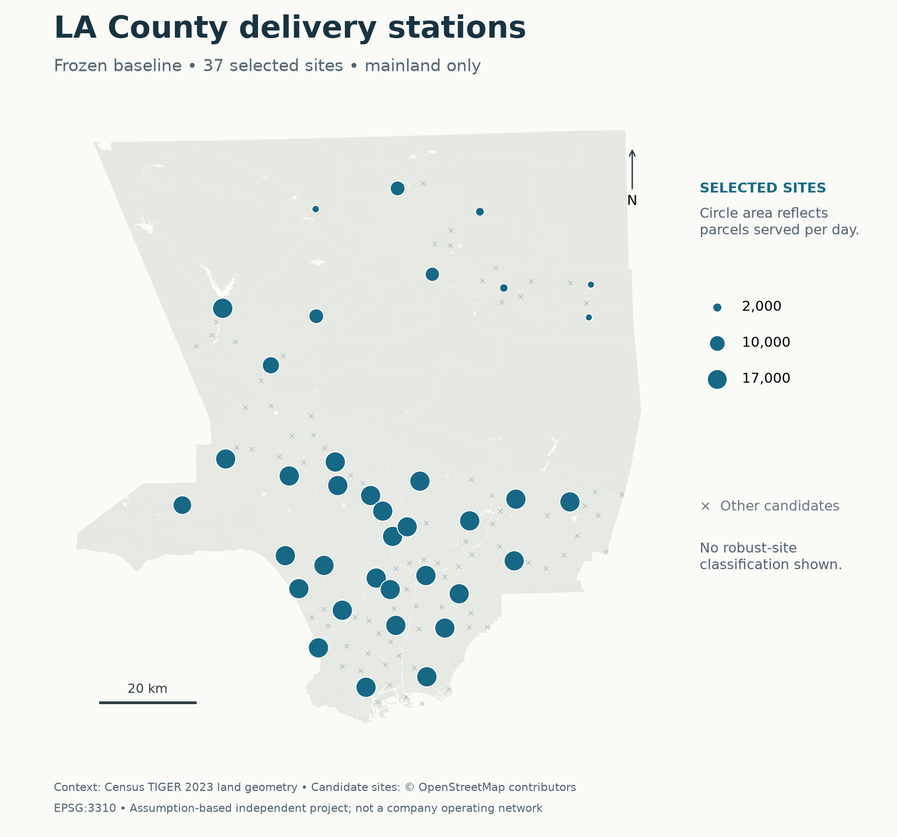

**Problem:** An independent project to decide how many delivery stations LA County needs and where to put them.

**Data:** Census households estimate parcel demand in small hexagonal areas (H3); OpenStreetMap supplies roads and industrial-land candidates.

**Method:** HiGHS mixed-integer optimization with station capacity, driving-time limits and one serving station per demand cell.

**Findings:** A **37-station network** planned for normal demand leaves about **13% of parcels unserved at a 40% peak**. Closing one station adds about **26 seconds to average driving time** under matched operating conditions. Covering the final **roughly 200 parcels/day** costs about **USD 570 extra per parcel in the model**.

## Scenario results

| Scenario | Active stations | Estimated unserved parcels/day | Cost gap (%) |
| --- | ---: | ---: | ---: |
| Normal demand | 37 | 0 | 1.7% |
| Peak: choose a new network | 50 | 0 | 4.8% |
| Peak: keep the normal-demand network | 37 | About 90,000 | <0.1% |
| Close one station | 36 | 0 | 0.1% |
| Capacity: 15,000 parcels/site/day | 47 | 0 | 3.2% |
| Capacity: 25,000 parcels/site/day | 32 | 0 | 2.9% |
| Fixed cost: USD 15,000/site/day | 38 | 0 | 3.5% |
| Fixed cost: USD 40,000/site/day | 38 | 0 | 4.1% |

**Column definitions:**

- **Scenario:** the demand or operating assumption changed. Peak demand is 40% above normal; fixed-network cases keep the selected sites.
- **Active stations:** sites open in the returned plan; the outage closes one of the normal-demand network's 37 sites.
- **Estimated unserved parcels/day:** daily demand the plan does not serve, rounded for display. It comes from household-based estimates, not observed parcel counts.
- **Cost gap (%):** the difference between the plan's modeled daily cost and the solver's proven lower bound, divided by the plan's modeled daily cost. A 1.7% gap means at most another 1.7% of the current modeled cost could be saved under the same assumptions. Percentages are rounded for display; smaller means less room for improvement.

The fixed-network peak case has a cost gap below 0.1% yet leaves about 90,000 parcels unserved: it is a tightly solved plan for a network that cannot meet the service target under these rules.

Daily modeled cost combines station costs, travel costs and a penalty for unserved parcels. The penalty is a modeling device, not a carrier bill. The roughly USD 570 figure compares earlier model totals; excluding penalties, the corresponding additional operating spend was about USD 670 per extra parcel. These are comparisons between computed plans, not shipping quotes. [Cost calculation and assumptions](docs/project-guide.md#the-cost-of-the-last-004-of-demand).

The outage comparison allows 100% utilization and up to 45 minutes of driving in **both** the no-closure control and the closure case. Both serve all modeled demand; their parcel-weighted mean driving times differ by about 26 seconds. [Matched outage control](docs/outage-control.md).

The table covers 1,615 modeled cells. Another 250 structurally uncovered mainland cells remain separately reported; islands are excluded. The plans are valid solutions found within the time budget, not proven best plans. Larger cost gaps leave station counts and cost-sensitivity conclusions unresolved. [Full results](docs/quality-results.md) · [Metric definitions and both geographic scopes](docs/metrics.md) · [Setup and methods](docs/project-guide.md).

